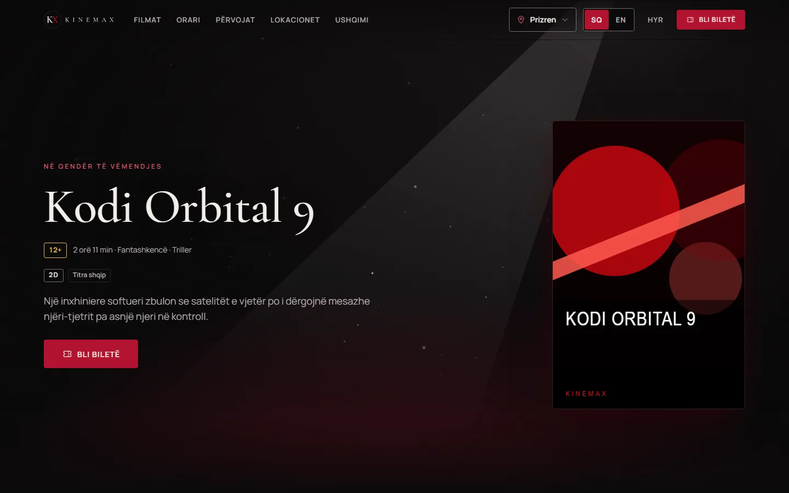
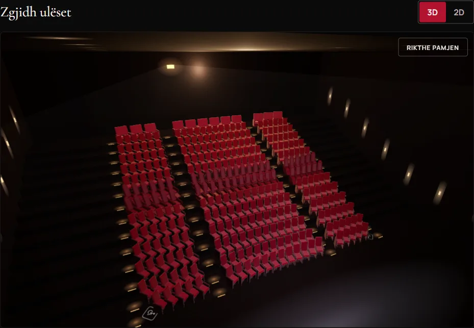
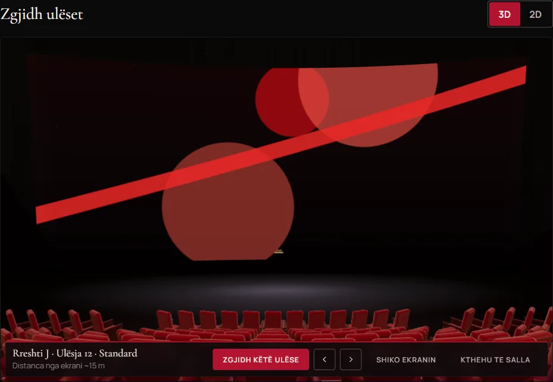
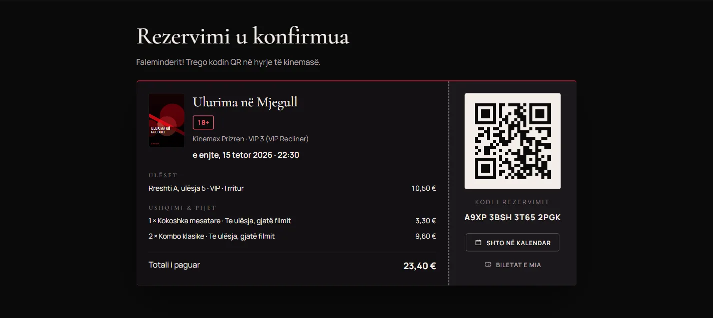
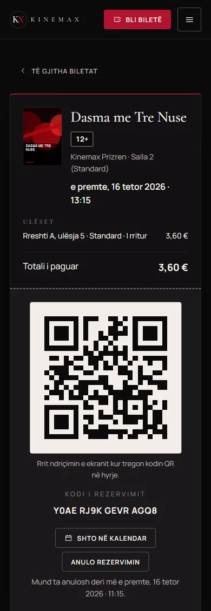
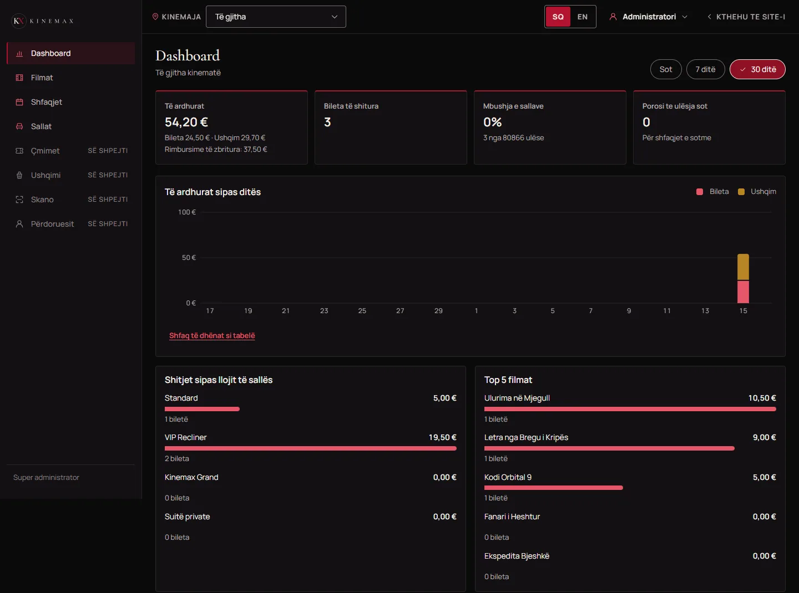
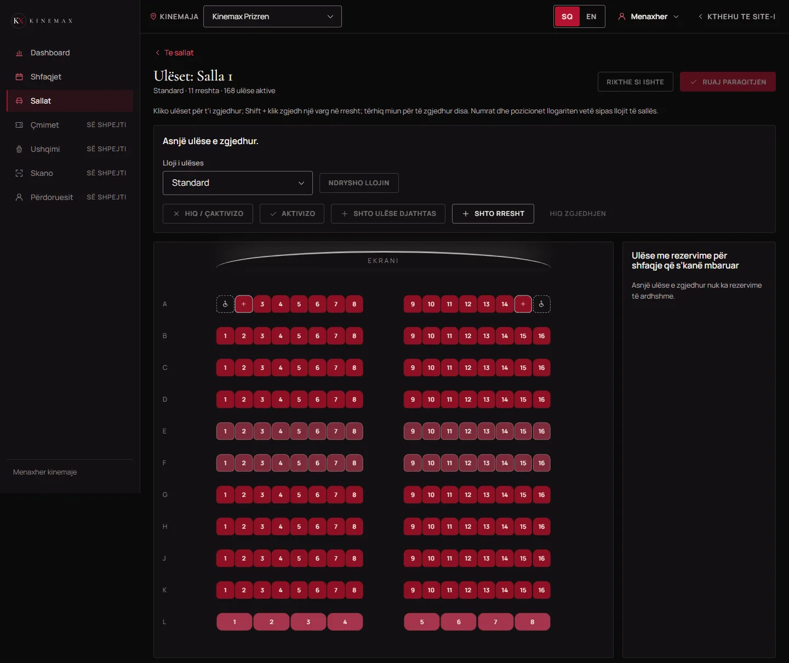
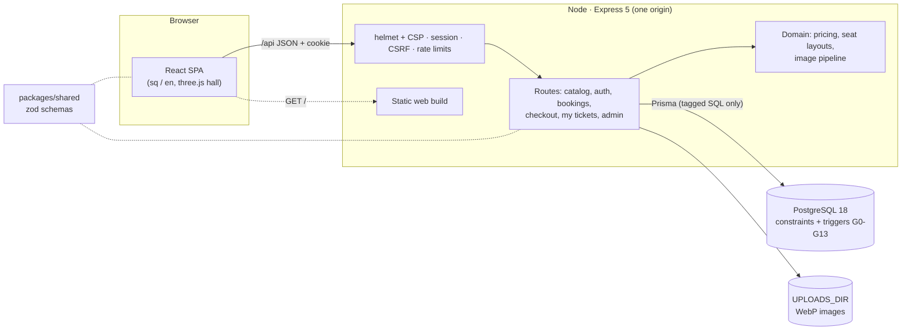

# Kinemax

> **Shqip:** Kinemax është uebfaqja e një zinxhiri kinemash premium **fiktiv** me katër lokacione
> në Kosovë: filmat dhe orari, zgjedhja e ulëseve në një sallë 3D me pamjen nga ulësja, ushqimi i
> porositur bashkë me biletat, pagesa DEMO me biletë QR, llogaritë e përdoruesve dhe një panel
> administrimi (shfaqjet, sallat, çmimet, ushqimi, skanimi i biletave, përdoruesit). Në shqip dhe
> anglisht, me çmime në EUR. Projekt portfolio, jo kinema e vërtetë.

A full-stack cinema booking site for a fictional premium cinema chain: React 19 + Express 5 +
PostgreSQL 18, TypeScript end to end, with the hard rules (no double booking, server-side prices)
enforced in the database itself.



## Features

- **Catalog**: four cinemas, now showing / coming soon, movie pages with trailers
  (youtube-nocookie), a 7-day schedule with filters kept in the URL.
- **3D seat selection** (three.js / react-three-fiber): every hall is a real 3D model (stadium
  tiers, VIP recliners, couple sofas, private suites, a curved premium screen); pick a seat and
  fly to the **view from that seat**. A 2D map does the same job on small screens and for
  keyboard users.
- **Booking flow**: timed seat holds, ticket categories, food & drinks served at the seat or
  picked up, server-side prices, a DEMO payment (success or decline) and a ticket with a QR code.
- **My tickets**: upcoming / past / cancelled, cancellation with an automatic refund before a
  cutoff, add to calendar.
- **Admin panel** (super admin and per-cinema managers): sales and occupancy dashboard, movies
  with secure image upload, showtimes (single and bulk, overlap-proof), a hall and seat editor
  with 3D preview, versioned prices, settings, the menu per cinema, a seat-delivery list, a QR
  ticket scanner (camera or typed code), users and roles, and an audit log.
- **Albanian (default) and English**, EUR, WCAG AA contrast, keyboard navigation, reduced motion.

| 3D hall                                                         | View from the seat                                                      |
| --------------------------------------------------------------- | ----------------------------------------------------------------------- |
|  |  |

| Ticket confirmation with QR                                                | Mobile ticket                                                           |
| -------------------------------------------------------------------------- | ----------------------------------------------------------------------- |
|  |  |

| Admin dashboard                                                                 | Seat editor                                                   |
| ------------------------------------------------------------------------------- | ------------------------------------------------------------- |
|  |  |

## Tech stack

| Part              | Tech                                                                          |
| ----------------- | ----------------------------------------------------------------------------- |
| `apps/web`        | React 19, Vite, react-router, three.js + react-three-fiber, CSS modules       |
| `apps/api`        | Node, Express 5, Prisma 7 (pg driver adapter), zod, argon2, sharp, helmet     |
| `packages/shared` | zod schemas and types shared by the web app and the API                       |
| Database          | PostgreSQL 18 (exclusion constraints, triggers, custom SQLSTATEs)             |
| Tooling           | TypeScript strict, ESLint, Prettier, Vitest, Supertest, Playwright + axe-core |

No UI library or CSS framework: a small design system with tokens and components, shown on a
living styleguide (`/styleguide`, development only).

## Architecture



In development Vite serves the web app and proxies `/api`; in production the API serves the
built web app itself ([docs/deployment.md](docs/deployment.md)). Either way the browser talks to
one origin.

## Guarantees in the database

The rules that must never break are enforced by PostgreSQL, not only by the code
([docs/data-model.md](docs/data-model.md)):

- **No double booking**: a seat can be held or sold only once per showtime (primary keys on live
  seat locks, composite foreign keys, a guard trigger); private suites are only sold whole, once.
- **No overlapping shows**: an `EXCLUDE USING gist` constraint keeps active showtimes in a hall
  apart.
- **A booking status machine** (HELD → CONFIRMED → CANCELLED/REFUNDED) in a trigger: expired holds
  cannot be paid, released bookings never come back, and releasing frees the seats atomically.
- **Couple sofas** take exactly two tickets with one surcharge (deferred count trigger).
- **Money is integer cents in EUR**, never negative; prices are computed on the server only.
- Trigger errors use their own SQLSTATEs (`KX001`-`KX006`), mapped to 409/422 by code, never by
  message text.

## Security highlights

Details, threat model and the findings of the final review: [docs/security.md](docs/security.md).

- argon2id passwords, server-side sessions (only token hashes stored), rotation on login,
  `__Host-` Secure cookies in production.
- CSRF tokens + Origin checks on every write; zod validation of every body, param and query.
- Role and per-cinema authorization; other users' bookings answer 404 (IDOR-tested).
- A **route inventory test** reads every registered API route and fails if one is reachable
  without sign-in, lets a customer into `/api/admin`, skips CSRF or validation, or (for sensitive
  writes) has no rate limit.
- A strict Content-Security-Policy (no inline scripts or styles, only youtube-nocookie frames),
  `frame-ancestors 'none'`, HSTS in production.
- Uploads: type from magic bytes, re-encoded to WebP without metadata, random names, sandboxed.
- Supply chain: pinned versions, an install-script allowlist and an `npm audit` gate.

## Quick start (Windows)

Prerequisites: Node.js 22.22+ (developed with Node 24), npm 11.16+, Git, PostgreSQL 18.

1. Install PostgreSQL 18 (for example `winget install --id PostgreSQL.PostgreSQL.18`), local
   connections only (`listen_addresses = 'localhost'`, `pg_hba.conf` allows `127.0.0.1/32` and
   `::1/128` with `scram-sha-256`). As the `postgres` superuser, create the app role and two
   databases (use your own password):

   ```sql
   CREATE ROLE kinemax WITH LOGIN PASSWORD 'CHANGE_ME' CREATEDB;  -- not a superuser
   CREATE DATABASE kinemax OWNER kinemax;       -- development
   CREATE DATABASE kinemax_test OWNER kinemax;  -- tests only
   ```

2. Install and run:

   ```powershell
   git clone <repo> kinemax
   cd kinemax
   copy .env.example .env      # put the kinemax password into both database URLs
   npm install                 # also generates the Prisma client
   npx playwright install chromium
   npm run db:migrate          # migrations on the development database
   npm run db:seed             # demo data; generates the demo passwords into .env
   npm run dev                 # web http://localhost:5180, API http://127.0.0.1:3001
   ```

The API checks its environment at startup and lists every missing or invalid variable
(`.env.example` documents them; production rules are in [docs/deployment.md](docs/deployment.md)).
`npm run db:reset` wipes and re-seeds the development database after you type its name; tests and
scripts refuse to touch anything but `kinemax_test`.

### Demo accounts

The seed creates these users (`.test` addresses, so no mail can reach anyone). Their passwords are
generated into your `.env` (`SEED_SUPER_ADMIN_PASSWORD`, `SEED_MANAGER_PASSWORD`,
`SEED_CUSTOMER_PASSWORD`) and never printed:

| Email                                                       | Role                        |
| ----------------------------------------------------------- | --------------------------- |
| `admin@kinemax.test`                                        | Super admin                 |
| `menaxher.<prishtine\|prizren\|peje\|ferizaj>@kinemax.test` | Cinema manager (one cinema) |
| `klient1@kinemax.test`, `klient2@kinemax.test`              | Customer                    |

The ticket scanner (`/admin/scan`) uses the camera, which browsers only allow on https or
localhost; elsewhere it falls back to typing the code.

## Tests

| Command            | What runs                                                                     | Count                                         |
| ------------------ | ----------------------------------------------------------------------------- | --------------------------------------------- |
| `npm test`         | Vitest: shared, API unit + integration (real PostgreSQL, `kinemax_test`), web | 892 (shared 39, API 393, web 450, scripts 10) |
| `npm run test:cov` | The same with coverage (80% minimum)                                          |                                               |
| `npm run e2e`      | Playwright on the production build: desktop + 390 px phone, axe accessibility | 89 (4 skipped per viewport by design)         |
| `npm run verify`   | lint, typecheck, test:cov, build, e2e and the audit gate                      |                                               |

Other scripts: `npm run lint`, `npm run typecheck`, `npm run build`, `npm run audit`
(`audit:dev` for the full report), `npm run db:studio`, `npm run brand:generate -w @kinemax/web`.

## Documentation

- [docs/data-model.md](docs/data-model.md): tables, database guarantees, SQLSTATEs
- [docs/auth.md](docs/auth.md): sessions, CSRF, roles, rate limits
- [docs/security.md](docs/security.md): threat model, controls, review findings, production TODOs
- [docs/deployment.md](docs/deployment.md): production checklist
- [docs/roadmap.md](docs/roadmap.md): what was built, in order, and future ideas

## Notes

- **Kinemax is fictional.** This is a personal portfolio project, not a real cinema. Movies,
  posters, cinemas and people in the demo data are invented; the poster art is abstract and
  generated. Payments are a demo: no card data is ever collected.
- **Fonts**: Cormorant Garamond and Manrope, self-hosted from Fontsource under the
  [SIL Open Font License 1.1](https://openfontlicense.org/) (see
  `apps/web/src/assets/brand/FONT-LICENSE.md`). The KX logo letters are outlines taken from
  Cormorant Garamond.
- Dependency install scripts are restricted by npm's `allowScripts` policy (root `package.json`,
  `strict-allow-scripts=true` in `.npmrc`); the accepted audit exceptions (Prisma CLI only) are
  documented in `scripts/audit-gate-core.ts` and [docs/security.md](docs/security.md).
