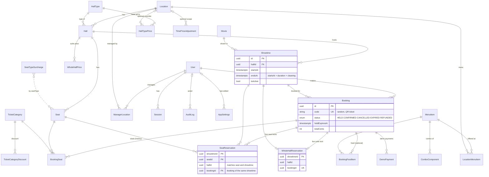

# Kinemax data model

PostgreSQL 18 via Prisma 7 (`apps/api/prisma/schema.prisma`, migration `init_domain`). Everything
the money and booking flows depend on is enforced **by the database**, not only by application code.

Conventions:

- **Money** is integer cents (EUR). Never floats.
- **Time** is `timestamptz` in UTC. Every database session runs with `TimeZone=UTC` (see G0). Each
  location has an IANA time zone (`Europe/Belgrade` in Kosovo) used for display and day/time pricing.
- **Texts** have per-language columns: `*Sq` (Albanian, required) and `*En` (English, optional; the
  UI falls back to Albanian). Location names, cities and addresses are proper nouns and have one
  column.
- **IDs** are UUID v7. Public booking codes are separate random 16-character Crockford base32 codes.

## ER diagram

## Tables

**Locations and halls**

- `Location`: a cinema (slug, name, city, address, IANA time zone, active flag).
- `HallType`: data, not an enum, so new formats need no migration. Code, texts, feature codes and
  `allowsSeatDelivery` (food to the seat). Seeded: STANDARD, VIP_RECLINER, PREMIUM_LARGE_FORMAT
  ("Kinemax Grand", our own name), PRIVATE_SUITE.
- `Hall`: location, type, name, active flag, `wholeHallOnly` (suites) and screen geometry (width,
  height, x/y/z in meters) for the future 3D seat map.
- `Seat`: row label, number, seat type (STANDARD, VIP, COUPLE = one sofa for two, WHEELCHAIR = space
  without a seat, COMPANION), 3D position (x = left/right of the center line, y = distance from the
  screen, z = tier height), yaw towards the screen, width in seat units, active flag.

**Movies and showtimes**

- `Movie`: slug, titles and synopses (sq/en), duration, age rating, genres, release date, poster and
  backdrop paths, optional YouTube trailer id (played via youtube-nocookie.com only after a click),
  director, cast, status (COMING_SOON, NOW_SHOWING, ARCHIVED).
- `Showtime`: movie, hall, `startsAt`, `endsAt` (duration + cleaning buffer), format (2D/3D),
  language version, active flag.

**Pricing** (the super admin can change all of it; `validFrom`/`validTo`/`isActive` keep history)

- `HallTypePrice`: base ticket price per hall type, optionally for one location (beats the global
  rule).
- `SeatTypeSurcharge`: surcharge per seat type. VIP: added to each VIP ticket. COUPLE: charged
  once per sofa (seed: €2.00), see "Couple sofas" below.
- `TimePriceAdjustment`: percent or fixed adjustment for ISO weekdays and a local time window
  `[startMinute, endMinute)` within one day, optionally per location, with a priority.
- `TicketCategory` + `TicketCategoryDiscount`: ADULT, STUDENT, CHILD, SENIOR with percent or fixed
  discounts.
- `WholeHallPrice`: price per showtime for halls sold as a whole (suites).

The server calculates every price with `apps/api/src/domain/pricing.ts` (pure, unit-tested). A
ticket is base + seat surcharge (VIP), then one time adjustment (highest priority, then
location-specific, then newest), then the category discount; percentages round half away from
zero, totals never go below 0. Rule versions are picked by the purchase time (`pricedAt`), time
windows by the showtime start in the location's time zone. Bookings store the full breakdown as a
snapshot. `priceSeatTickets` prices any seat (1 or 2 tickets); `priceSeat` prices single-ticket
seats.

**Couple sofas.** A COUPLE sofa is one seat (one lock) for two people and sells **two tickets**,
one per person, each with its own ticket category (e.g. ADULT + STUDENT), each priced like a normal
ticket of that hall type at that time (base, time adjustment, category discount). On top comes the
COUPLE surcharge **once per sofa**, as a flat amount: no time adjustment and no discount apply to
it. Example (Thursday 20:00, base €4.50): ADULT €4.50 + STUDENT €3.60 + sofa €2.00 = €10.10.

**Users and administration**

- `User`: normalized email (unique), argon2id `passwordHash`, name, preferred locale, role
  (CUSTOMER, LOCATION_MANAGER, SUPER_ADMIN), active flag.
- `ManagerLocation`: which locations a manager manages.
- `Session`: SHA-256 hash of the session token only (never the raw token), user, expiry, last seen,
  user agent.
- `AppSettings`: one row: seat hold minutes (10) and cancellation cutoff (120 minutes before the
  show).
- `AuditLog`: actor, action, entity, before/after JSON, timestamp (prices, roles, settings, admin
  edits).

**Bookings, food and payments**

- `Booking`: user, showtime, status, hold expiry, total, currency (EUR), age-rating confirmation,
  public code, timestamps; for suites `isWholeHall` + whole-hall price snapshot.
- `BookingSeat`: one row per **ticket** on a booked seat (permanent history, kept after
  cancellation): seat, `occupant` (1, or 1..2 on a COUPLE sofa), ticket category, ticket price,
  price breakdown, and `seatSurchargeCents` (the once-per-sofa surcharge, on occupant 1 only).
  Unique `(bookingId, seatId, occupant)`. A seat's total is its tickets plus its surcharge.
- `SeatReservation` / `WholeHallReservation`: live locks (see G10/G11).
- `MenuItem` (+ `ComboComponent`), `LocationMenuItem` (availability and price per location),
  `BookingFoodItem` (optional food with name and price snapshot, fulfillment PICKUP_AT_COUNTER or
  DELIVER_TO_SEAT; delivery only in hall types with `allowsSeatDelivery`, checked in
  `apps/api/src/domain/fulfillment.ts`).
- `DemoPayment`: demo provider only; there are no card number, CVC or expiry columns anywhere.

## Database-level guarantees

The raw SQL lives at the end of the migrations: G0-G11 in `*_init_domain`, G12 in
`*_couple_seat_two_tickets`, and `*_trigger_error_codes` replaces the trigger functions so they
raise the custom error codes below. Prisma ignores these objects when diffing (verified: diffing
the database against the schema produces an empty migration).

### Error codes

Our trigger functions raise dedicated SQLSTATEs of the custom class `KX` (classes starting with
I-Z are implementation-defined in the SQL standard and PostgreSQL uses no `KX` class), so the API
can tell them apart from built-in errors without reading message text, which PostgreSQL may
translate (`lc_messages`). The constants live in `apps/api/src/db/domain-error-codes.ts`.

| Code  | Raised by                                                | Meaning                                                                        | HTTP |
| ----- | -------------------------------------------------------- | ------------------------------------------------------------------------------ | ---- |
| KX001 | `kinemax_booking_status_guard` (G9)                      | booking status transition not allowed (also: new booking not HELD)             | 409  |
| KX002 | `kinemax_booking_status_guard` (G9)                      | hold expired: a HELD booking can no longer be confirmed                        | 409  |
| KX003 | `kinemax_reservation_guard` (G10)                        | seat/whole-hall lock needs an active (HELD or CONFIRMED) booking               | 409  |
| KX004 | `kinemax_reservation_guard` (G10)                        | per-seat lock in a whole-hall-only hall, or whole-hall lock in a per-seat hall | 422  |
| KX005 | `kinemax_booking_seat_occupant_guard`, count check (G12) | occupant above the seat's ticket capacity, or wrong ticket count at COMMIT     | 422  |
| KX006 | `kinemax_seat_type_change_guard` (G12)                   | seat with tickets cannot change to a type with a different ticket capacity     | 409  |

CHECK constraints keep the standard 23514 (mapped to 422), unique 23505, exclusion 23P01,
foreign key 23503 and RESTRICT 23001. The full HTTP mapping is in [auth.md](auth.md#error-mapping).
Integration tests: `apps/api/test/db/guarantees.db.test.ts`.

| #   | Guarantee                                                                                                                 | How                                                                                    |
| --- | ------------------------------------------------------------------------------------------------------------------------- | -------------------------------------------------------------------------------------- |
| G0  | Timestamps are stored exactly in UTC                                                                                      | Database default `TimeZone=UTC` + app pool option `-c TimeZone=UTC`                    |
| G1  | Range constraints can combine uuid and time ranges                                                                        | `btree_gist` extension (trusted; created by the DB owner `kinemax`)                    |
| G2  | Two active showtimes never overlap in a hall; `endsAt > startsAt`                                                         | `EXCLUDE USING gist (hallId =, tstzrange(startsAt, endsAt, '[)') &&) WHERE isActive`   |
| G3  | Money is never negative; quantities are positive; only EUR                                                                | CHECK constraints on every price/amount/quantity/currency column                       |
| G4  | Price rules are sane                                                                                                      | CHECK: validTo > validFrom, window inside one day, ISO weekdays 1-7, percent ranges    |
| G5  | Catalog sanity                                                                                                            | CHECK: duration 1-600, YouTube id shape, seat number/width, couple sofa = 2 units      |
| G6  | One account per email, case-insensitively                                                                                 | Unique email + CHECK `email = lower(btrim(email))`                                     |
| G7  | Exactly one settings row with sane values                                                                                 | CHECK `id = 1`, value ranges; defaults inserted by the migration                       |
| G8  | Bookings are consistent                                                                                                   | CHECK: code format, HELD has an expiry, status timestamps, whole-hall price, demo only |
| G9  | Bookings follow the status machine; released bookings never come back; expired holds cannot be confirmed                  | `BEFORE INSERT OR UPDATE OF status` trigger                                            |
| G10 | A seat is never held/booked twice for a showtime; locks stay inside the showtime's hall; suites are only sold whole, once | PK `(showtimeId, seatId)`, PK `showtimeId` for suites, composite FKs, guard trigger    |
| G11 | Releasing a booking frees its seats atomically                                                                            | `AFTER UPDATE OF status` trigger deletes the live locks                                |
| G12 | A COUPLE sofa has exactly 2 tickets per booking, every other seat exactly 1; the sofa surcharge is charged once           | Occupant CHECK + capacity trigger, deferred count trigger, seat-type change guard      |

### Why a separate lock table (G10/G11)

`BookingSeat` is history: it keeps every seat ever booked with its price snapshot, including
cancelled ones, so it cannot carry a "one booking per seat" unique key. `SeatReservation` holds
only the **live** locks: one row per `(showtimeId, seatId)` while the booking is HELD or CONFIRMED.

- The primary key `(showtimeId, seatId)` makes a second hold of the same seat fail with a unique
  violation, also under concurrency (one of N parallel holds wins; tested).
- Composite foreign keys `(seatId, hallId) -> Seat(id, hallId)`, `(showtimeId, hallId) ->
Showtime(id, hallId)` and `(bookingId, showtimeId) -> Booking(id, showtimeId)` make it impossible
  to lock a seat of another hall or for another showtime than the booking's.
- A guard trigger allows locks only for HELD/CONFIRMED bookings (reading the booking `FOR SHARE`,
  so it serializes with a concurrent status change), forbids per-seat locks in whole-hall-only halls
  and whole-hall locks anywhere else.
- When a booking becomes CANCELLED, EXPIRED or REFUNDED, a trigger deletes its locks in the same
  transaction, so the seats are immediately bookable again; the status machine (G9) prevents a
  released booking from becoming active without new locks.
- Suites use `WholeHallReservation` with `showtimeId` as primary key: one whole-hall booking per
  showtime, and no per-seat booking can coexist.

A HELD booking whose `holdExpiresAt` has passed still holds its locks until it is marked EXPIRED.
The future hold endpoint must expire stale holds of the showtime in the same transaction before
locking seats (`UPDATE "Booking" SET status = 'EXPIRED' WHERE status = 'HELD' AND "holdExpiresAt"
<= now() ...`); G9 already prevents confirming an expired hold.

### Two tickets per sofa (G12)

The lock and the tickets are separate on purpose: a sofa is **one** `SeatReservation` row (one lock,
so it can never be split between two bookings) but **two** `BookingSeat` rows (two people, two
categories, two price snapshots). The ticket count is enforced in layers:

- `kinemax_seat_ticket_capacity(seatType)` returns 2 for COUPLE and 1 otherwise; the domain mirror
  is `apps/api/src/domain/seat-tickets.ts`, used by the pricing function.
- **At most**: CHECK `occupant BETWEEN 1 AND 2`, a `BEFORE INSERT/UPDATE` trigger that rejects an
  occupant number above the seat's capacity, and the unique key `(bookingId, seatId, occupant)`.
  So a standard seat can only have occupant 1, a sofa only occupants 1 and 2.
- **At least**: a `DEFERRABLE INITIALLY DEFERRED` constraint trigger checks at COMMIT that every
  booked seat has 0 or exactly `capacity` tickets. Deferring the check lets the application write
  the two tickets one after the other in the same transaction, while a transaction that leaves a
  sofa with one ticket can never commit.
- **Surcharge once**: `seatSurchargeCents` is never negative and may only be non-zero on
  occupant 1 (CHECK).
- **Stays true later**: a seat with tickets cannot change to a seat type with a different capacity
  (e.g. COUPLE to STANDARD); deactivate it and add a new seat instead. Same-capacity changes
  (STANDARD to VIP) are allowed.

Tickets written before this migration are kept as history (the migration only reports mismatches).
Errors raised at COMMIT of an interactive transaction surface from Prisma as a `DriverAdapterError`
with the SQLSTATE in `cause.originalCode`, not as a `PrismaClientKnownRequestError`.

## Seed

`npm run db:seed` (development database only; refuses `*_test` and `NODE_ENV=production`) creates
4 locations, 16 halls, ~2,000 seats generated by `apps/api/src/domain/seat-layout.ts`, 12 fictional
movies with abstract SVG placeholders in `apps/web/public/seed/`, 14 days of showtimes, price rules,
per-location menus and demo users. Demo passwords are generated into `.env` (`SEED_*`) and never
printed. The seed is idempotent; `npm run db:reset` re-runs migrations and the seed.
